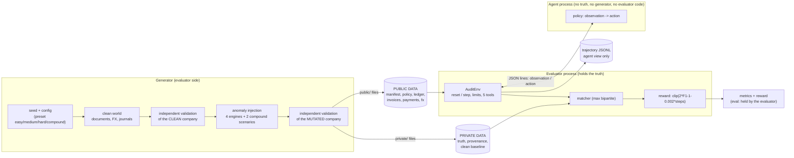
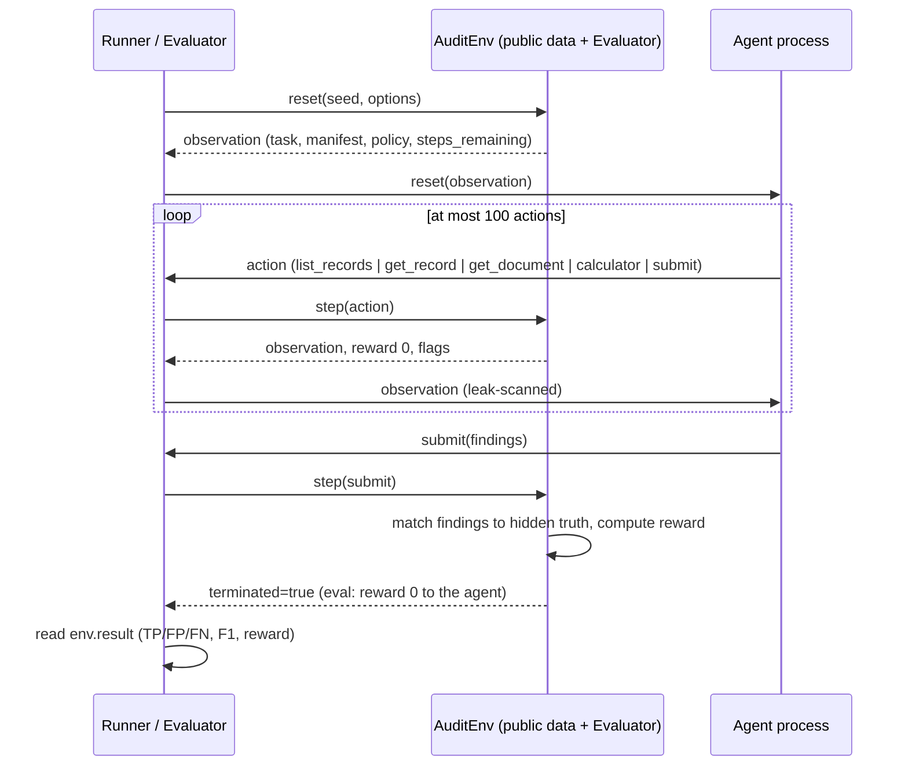

# ARCHITECTURE

TraceForge is an offline, reproducible RL environment for financial-audit agents. This document explains how it is
built and *why each boundary exists*. File paths refer to `src/traceforge/`. Everything described here exists in the code
and is covered by tests (see `SPEC_COMPLIANCE.md`).

## System overview



## One episode, step by step



## 1. Synthetic data generation (`generator/`)

A company is built **before** any error exists. `financial_world.py` creates the period (a calendar month in a fixed UTC
offset), counterparties (each with one currency and its own time zone, some far ahead/behind the company clock), a daily FX table
(integer basis-point random walk on `Decimal`, 8-decimal strings) and the documents; `documents.py` makes invoices and the
payment behaviour (paid in full, two-part, partial, split across invoices, unpaid); `clean_cases.py` adds legitimate look-alikes;
`ledger.py` posts double-entry journals.

* **Money** is integer minor units; FX uses `Decimal` with `ROUND_HALF_UP` per ledger line (`money.py`). No float touches money (an AST test enforces it).
* **Posting rules**: invoice `Dr 1200 | Cr 4000`; payment `Dr 1000 (sum of lines) | Cr 1200 per invoice_ref | Cr 2300 for the unallocated rest`; refunds mirror this. The rate date is the calendar date of the document timestamp in the company time zone.
* **Decoys in every episode**: repeated amounts, same amount at different counterparties, recurring invoice series, refunds, overpayments, split payments, and payments within the hour of a period edge from another time zone (their local date differs from the company date).
* **Determinism**: all randomness comes from `random.Random` instances seeded from `seed|attempt|purpose`; the global RNG is never used; output is identical across processes and `PYTHONHASHSEED` values.
* **Validation** (`validation.py`) is an *independent* implementation of the posting rules: it rebuilds the clean ledger from documents alone and must equal the stored baseline; then the mutated ledger must equal baseline + the mutation manifests; the detector re-derives every issue from public data and must equal the truth one-to-one.

## 2. Financial anomaly injection (`generator/mutations.py`, `compound_scenarios.py`)

Four independent engines, each touching the journal of **one** document (a document is mutated at most once, journals stay balanced):

| type | root cause | variants |
|---|---|---|
| `duplicate` | `journal_posted_twice` | repost of an invoice or payment |
| `allocation` | `allocation_not_applied` / `_partially_applied` / `_applied_to_wrong_invoice` | `unallocated`, `partial`, `wrong_invoice` |
| `fx` | `wrong_fx_rate_used` / `fx_rate_of_wrong_date_used` | `wrong_rate`, `wrong_date` |
| `cutoff` | `booked_in_wrong_reporting_period` | period shift across an edge |

**Difficulty profiles** decide which variants appear and how subtle they are (easy: direct; medium: cross-referencing; hard: indirect,
small differences, reposts of documents that have a legitimate twin). **Compound scenarios** put two anomalies on different journals of one story:
`cross_border_partial` (a mis-allocated partial payment + a wrong-date FX rate on a payment of the same foreign invoice) and
`period_end_duplicate` (a reposted invoice + its lookalike booked into the next period). Each anomaly is its own truth record with its own evidence.

## 3. Hidden ground truth and provenance isolation

Each episode is stored as two physical folders. `public/` = what an agent may ever see. `private/` = `truth.json`
(issue id, type, affected ids, expected amount, currency, allowed evidence sets, root cause, detailed explanation),
`provenance.json` (mutation manifests with source/modified rows, causal descriptions, scenarios, validation report) and `clean_baseline.json`.

* **Row ids are assigned after injection and the final sort**, so an id never reveals which rows were injected.
* The **truth lives only in the evaluator process** (`evaluation/evaluator.py`). The agent runs in a **separate OS process** (`environment/isolation.py`) with a scrubbed environment and an empty working directory; the worker imports neither generator nor evaluator code.
* Every observation, `info` and trajectory is scanned for private tokens (`assert_no_leak`). The oracle policy is evaluator-side only: not in the agent registry, refused by the worker.
* **Seeds and episode ids.** The generated `episode_id` an agent sees is a digest of the episode's public content, not of the seed (a final-audit fix: it used to be `sha256(seed|config)`, from which a hidden seed could be recovered in milliseconds). The generator is open and deterministic, so a *guessable* seed still lets anyone regenerate an episode and its truth: hidden evaluation must use high-entropy seeds (>= 64 bits).
* Honest limits: process isolation does not stop an agent that can read the file system from opening stored `private/` folders (use in-memory episodes or a container). `AuditEnv` is the evaluator's object.

## 4. Agent observation and tool interface (`environment/`)

Gymnasium-style `reset(seed, options) -> (obs, info)` and `step(action) -> (obs, reward, terminated, truncated, info)`, all plain JSON.
An observation contains only: task text, manifest, the short financial policy (rate-date rule, rounding, period, finding conventions),
the last result, a bounded error, and the remaining steps. Five tools: `list_records` (stable pagination, <= 50 rows), `get_record`, `get_document`,
`calculator` (AST whitelist + `Decimal`, no `eval`), `submit`. Limits: 100 actions including submit; an unknown id or malformed action still costs a step; errors have
fixed texts that never echo input. 100 steps without `submit` truncates the episode with an empty answer. Returned records are copies.

## 5. Reward calculation (`evaluation/reward.py`)

```
F1 = 2*TP / (2*TP + FP + FN)         (F1 = 1 if there is no truth and no prediction)
terminal reward = clip(2*F1 - 1 - 0.002*inspection_steps, -1, 1)
```

Computed with exact fractions. Exploration steps give reward 0. An invalid submission structure ends the episode with reward -1 and an internal note.
`train` mode returns the terminal reward to the agent; `eval` mode returns 0 to the agent and the runner reads the full result from the evaluator afterwards.

## 6. One-to-one finding matching (`evaluation/matcher.py`)

A finding can be a true positive for a truth issue only if **all five** hold: same type; `affected_ids` equal as sets; amount within +-1 minor unit;
same currency; evidence contains a *complete* allowed evidence set (extra or unknown ids are harmless but never sufficient). Each finding matches at most one issue and each issue at most once.
The assignment is a **maximum bipartite matching** (augmenting paths), made deterministic by processing findings in a canonical order, so TP/FP/FN never depend on the order of the findings. It was verified against exhaustive search on 400 random instances.

## 7. Baseline policies (`policies/`, `evaluation/oracle_policy.py`)

| policy | side | idea |
|---|---|---|
| `random` | agent | seeded random actions, then 0-3 random guesses |
| `reconciliation` | agent | reads all tables, finds reposts, recomputes FX, compares allocations and periods; `verify=True` adds an evidence-checking phase with `get_document`, `get_record`, `calculator` (used by the demo) |
| `mark_all` | agent | accuses the most suspicious documents of every type (<= 30 findings) |
| `oracle` | **evaluator** | builds findings from the truth; proves the maximum reward is reachable |

Policies see only JSON observations and may run in an isolated subprocess (`runner/agent_worker.py`, newline-delimited JSON protocol); a crashing, hanging or flooding agent cannot hurt the runner and is scored as an empty submission.

## 8. Trajectory recording (`trajectories/`)

One JSON line per step: `episode_id, step, action, observation, reward, terminated, truncated`. Step 0 is the initial observation.
Trajectories contain **agent-visible data only**: no truth, no provenance, no seed. `replay()` re-executes the actions on a fresh environment and compares every observation, reward and flag.

## 9. Metamorphic evaluation (`generator/transformations.py`)

An episode is transformed without changing its economics: all `DOC/INV/PAY/ROW/ENT` identifiers are remapped field by field, ledger rows, documents and fx rows are shuffled,
neutral descriptions are renamed, and the truth/provenance/baseline are updated. `verify_links` then *proves* the links survived (row-by-row and document-by-document
isomorphism, injective mapping, no stale ids, referential integrity). Checks: an answer correct for the original, with ids translated, is correct on the transform; the oracle and the
reconciliation policy get identical scores, rewards and step counts on both; the original ids no longer score after remapping. 24 pairs are run by `verify` and written to `reports/transformation_report.json`.

## Reports and commands

`python -m traceforge demo` (fixed seed, narrated investigation, evaluator verdict, real benchmark, HTML report), `benchmark`, `audit`, `verify`, `generate`, `evaluate`, `inspect`.
The HTML report (`reporting/html_report.py`) is self-contained, uses inline SVG, and renders only data from the run that produced it.
