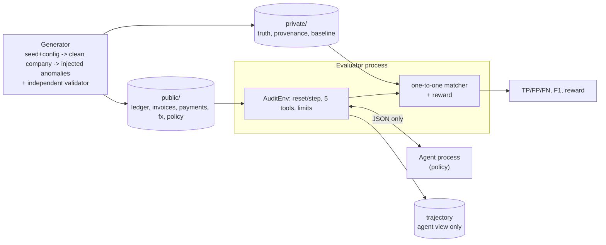

# JUDGE_SUMMARY

Short, factual overview. Every number comes from a command in this repository (see `FINAL_AUDIT.md` for the evidence and `FINAL_BENCHMARK.json` for the raw benchmark).

## 1. What TraceForge is
An offline, reproducible **reinforcement-learning environment** in which an agent audits a synthetic company. It generates a company with a consistent history, injects accounting errors whose ground truth is known, lets the agent investigate through five narrow tools, and scores the agent's structured findings. Pure Python standard library; no network, GPU, LLM or paid API.

## 2. The problem it solves
Real audit data is confidential and comes without a verified answer key, so audit agents are hard to evaluate or train. TraceForge supplies verifiable ground truth, and its reward punishes **both** missed errors and false accusations (legitimate look-alikes such as refunds, repeated amounts, split payments and boundary-time payments from other time zones are in every company).

## 3. Why this is not "an audit chatbot"
A chatbot answers a question once. Here the agent must act in a loop with a **budget** (100 steps, 50 rows per page; every look costs 0.002 reward), gather **evidence ids** that the evaluator checks mechanically, and submit a **structured** answer that is matched one-to-one against a hidden truth. The explanation text is not scored. This makes the task measurable, repeatable and trainable, which a free-text conversation is not.

## 4. How companies are generated
Seeded `random.Random` streams build a company *before* any error exists: counterparties with currencies and time zones, a daily FX table, invoices, and payments (full, partial, two-part, split, refunds, overpayments), then double-entry journals. Money is integer minor units, FX uses `Decimal` with half-up rounding. An **independent** validator rebuilds the clean ledger from documents alone and must agree.

## 5. How anomalies are injected
Four engines — duplicate posting, allocation (unapplied / partial / wrong invoice), FX (wrong rate / wrong date), reporting-period cut-off — each change one document's journal. Two compound scenarios combine two errors on one story. Difficulty levels (easy / medium / hard / compound) change which variants occur and how subtle they are. After injection the validator re-derives every discrepancy from **public data only**; the episode is accepted only if that equals the recorded truth one-to-one, so each error is findable and nothing unrecorded is wrong.

## 6. How evidence is investigated
Tools: `list_records` (paged), `get_record`, `get_document`, `calculator` (safe Decimal arithmetic), `submit`. A finding names its type, affected ids, amount (base-currency minor units), currency and **evidence ids** (source document, the ledger lines, the FX record the policy prescribes). The published policy states the conventions for each type.

## 7. How the evaluator works
Truth lives only in the evaluator process; the agent can run as a separate OS process and sees JSON only. A finding is a true positive only if type, affected ids (as a set), amount (±1 minor unit), currency and a **complete** allowed evidence set all match. Matching is a deterministic **maximum bipartite** assignment (each finding and each truth record used at most once), independent of finding order; unmatched findings are false positives, unreported errors false negatives.

## 8. Reward
`reward = clip(2·F1 − 1 − 0.002·inspection_steps, −1, 1)`, `F1 = 2TP / (2TP + FP + FN)` (F1 = 1 when there is nothing to find and nothing claimed). An invalid submission structure scores −1; exploration steps give 0. Verified against an independent Decimal implementation over a 7×7×7×10 grid and through the real environment.

## 9. Reproducibility
Same seed + config + code ⇒ byte-identical episode (checked across processes and `PYTHONHASHSEED` values; stored datasets regenerate bit-for-bit). The saved benchmark is re-derived by a test. Episodes can be re-labelled and shuffled without changing their economics (24 metamorphic pairs, link verification). Trajectories (agent view only) are replayable.

## 10. What the benchmark shows
`FINAL_BENCHMARK.json` — 52 episodes (10 train, 10 dev, 32 generated across easy/medium/hard/compound), 4 policies, identical episodes and conditions, eval mode, 208 runs:

| policy | TP / FP / FN (issues = 175) | precision | recall | F1 | reward | inspection steps |
|---|---|---|---|---|---|---|
| random | 0 / 156 / 175 | 0.000 | 0.096 | 0.000 | −1.000 | 20.0 |
| simple reconciliation | 175 / 0 / 0 | 1.000 | 1.000 | 1.000 | 0.968 | 16.2 |
| mark-everything | 2 / 1558 / 173 | 0.001 | 0.104 | 0.002 | −0.997 | 16.2 |
| oracle (evaluator only) | 175 / 0 / 0 | 1.000 | 1.000 | 1.000 | 1.000 | 0.0 |

(precision/recall/F1/reward/steps are means over episodes; an episode with no issues and no findings counts as precision = recall = 1, which is why random's mean recall is not 0.) What it demonstrates: accusing everything or guessing is punished; the top score is reachable (oracle); a transparent rule-based auditor can solve the episodes, as it must, because every error is derivable from public data. Harder levels cost it more steps (12 → 24) but not accuracy.

## 11. Limitations (stated plainly)
* The rule-based baseline is perfect, so the benchmark does **not** discriminate between strong agents yet (what it *does* show: `FINAL_ABLATION.json` - the same auditor with one capability removed scores 0.61-0.68 without one error family, 0.11 with half the reading budget, -0.00 with three false accusations, -0.61 with incomplete evidence or a wrong amount, and unchanged without explanation text); **no LLM or learned agent was run**, and nothing here claims model improvement.
* Isolation is process-level plus an audit-hook sandbox for **Python** agents (`python -m traceforge.runner.sandbox`: no writes, no reads outside the interpreter/agent folder, no `private/`, no sockets, no subprocess, no native libraries; attack-tested twice, with and without the sandbox). It is a speed bump, not an OS boundary: native code, non-Python agents and some Windows internals are not covered, so a hostile custom agent could still read files, use the network or spawn processes (the tool API itself cannot). Stored `private/` folders are readable by such an agent; use in-memory episodes or a container.
* The generator is open: anyone with the code and a **guessable** seed can regenerate an episode and its truth. Hidden evaluation must use high-entropy seeds (≥ 64 bits). The episode id an agent sees is a content digest and no longer reveals the seed (a flaw found and fixed in this audit).
* The ±1 minor-unit amount tolerance and the definition of `inspection_steps` (actions before submit, invalid ones included) are published choices of this implementation.
* Four error families, fixed UTC offsets (no DST), daily FX including weekends.
* Verified on Windows 11 / Python 3.12.0 only; Python 3.11, Linux and macOS are **not verified** (the code parses under the 3.11 grammar).

## Architecture

Run it: `python -m traceforge demo` (seed 7, about two seconds) and `python -m traceforge benchmark`; details in `ARCHITECTURE.md`.
